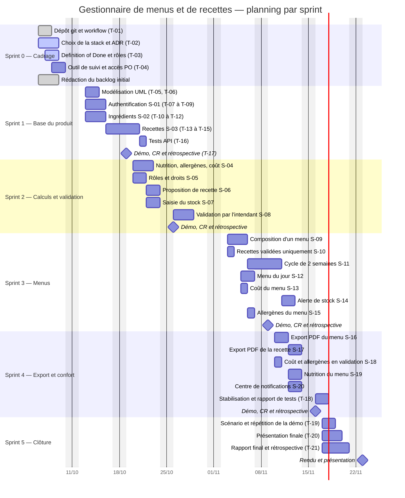

# Planning prévisionnel (Gantt)

> ⚠️ **Dates à ajuster** : les dates ci-dessous supposent une séance de TP par semaine à partir
> du 6 octobre 2026. Remplacer par les dates réelles des séances dès qu'elles sont connues —
> c'est l'écart entre ce planning et la réalité qui alimentera la rétrospective finale.

Un sprint = une séance de TP. Les tâches de documentation et de gestion de projet courent en
parallèle du développement et ne sont donc pas des jalons isolés.



## Chemin critique

```
S-02 (ingrédients) → S-03 (recettes) → S-04 (calculs) → S-08 (validation)
                                                      → S-09/S-11 (menus) → S-16 (PDF)
```

Tout part de l'**ingrédient** : c'est lui qui porte le coût, la nutrition et les allergènes dont
dépendent tous les calculs en aval. Un retard sur S-02 décale mécaniquement les sprints 2 et 3.

## Marges et risques

| Risque | Impact | Parade |
| --- | --- | --- |
| Sprint 1 planifié à ~104 % de la capacité | Report de S-03 | Sortir S-03 ou prévoir du travail hors séance (décision au planning) |
| Nouvelle demande du PO en cours de projet | Décalage du planning | Les stories `Could` (S-21, S-22) servent de variable d'ajustement |
| Export PDF sous-estimé (sprint 4) | Rendu incomplet | Prototyper l'export dès le sprint 3 sur une recette |
| Absence d'un membre à une séance | Perte de 25 % de la capacité | Réaffectation en début de séance, notée dans la page de sprint |
