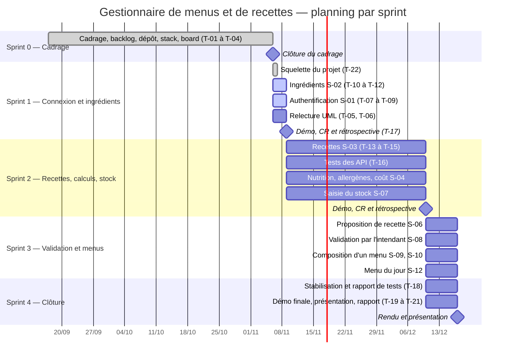

# Planning prévisionnel (Gantt)

Planning recalé le 06/11/2026 sur le calendrier réel des séances de 3 h : 17/09, 05/10, 13/10,
06/11, 09/11, 10/12 et 17/12. Le premier planning supposait une séance par semaine à partir du
06/10 ; il reste dans l'historique git. L'écart entre les deux alimentera la rétrospective finale.

Un sprint = une séance de TP, et le travail hors séance décidé par l'équipe compte dans le sprint
qu'il prépare. Les trois premières séances n'ont pas produit de livrable concret.



Les stories « à placer » (S-05, S-11, S-13 à S-20 : 29 points) n'ont pas de date : elles entrent
dans un sprint dès que la vélocité le permet, `Must` avant `Should`. Les sprints 3 et 4 se
recouvrent entre le 10/12 et le 17/12 : la séance du 10/12 est la dernière avant la clôture.

## Chemin critique

```
S-02 (ingrédients) → S-03 (recettes) → S-04 (calculs) → S-08 (validation)
                                                      → S-09/S-11 (menus) → S-16 (PDF)
```

Tout part de l'**ingrédient** : c'est lui qui porte le coût, la nutrition et les allergènes dont
dépendent tous les calculs en aval. Un retard sur S-02 décale mécaniquement les sprints 2 et 3.

## Marges et risques

| Risque | Impact | Parade |
| --- | --- | --- |
| Trois séances passées sans livrable | Moins de temps pour 68 points | Travail hors séance, aide de l'IA, report des stories « à placer » |
| 68 points pour environ 16 h de développement en séance | Rendu incomplet | Vélocité mesurée à chaque sprint, périmètre revu au planning |
| Un mois sans séance entre le 09/11 et le 10/12 | Pas de retour du PO pendant le sprint 2 | Travail hors séance planifié, avancement visible sur le board public |
| Younes est le seul à approuver les PR | Équipe bloquée en attente de relecture | PR petites, relues au fil de l'eau |
| Export PDF (S-16) encore « à placer » | Story `Must` non livrée | La prioriser dès que la vélocité le permet |
| Nouvelle demande du PO en cours de projet | Décalage du planning | Les stories `Could` (S-21, S-22) servent de variable d'ajustement |
| Absence d'un membre à une séance | Perte de 25 % de la capacité | Réaffectation en début de séance, notée dans la page de sprint |
