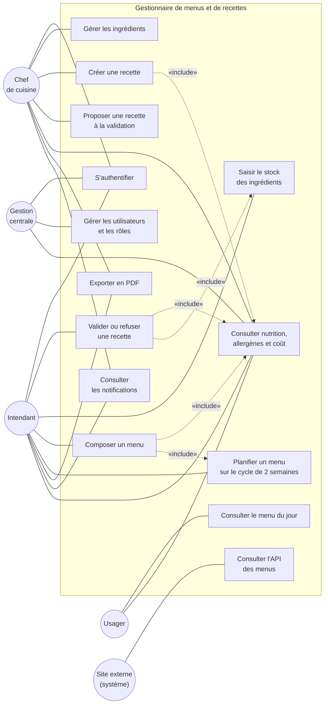

# Diagramme de cas d'usage (T-05)

## Acteurs

| Acteur | Description |
| --- | --- |
| **Chef de cuisine** | Crée des recettes et les propose à la validation ; consulte les recettes validées |
| **Intendant** | Saisit le stock, valide ou refuse les recettes, compose et publie les menus |
| **Gestion centrale** | Administre les utilisateurs et les rôles, supervise les coûts |
| **Usager** | Consulte le menu du jour, les allergènes et la nutrition (sans compte) |
| **Site externe** | Acteur secondaire (système) : consomme l'API des menus |

## Relations notables

| Relation | Signification |
| --- | --- |
| `UC6 «include» UC7` | Valider une recette suppose de connaître le stock disponible |
| `UC8 «include» UC4` | Composer un menu s'appuie sur le coût et les allergènes des recettes |
| `UC8` → recettes validées uniquement | Règle métier de la story S-10 : une recette non validée n'est pas utilisable dans un menu |

## Règles métier rattachées

1. Un menu contient **2 protéines, 1 féculent, 1 légume et 1 plat végétarien** (S-09).
2. Les menus tournent sur un **cycle de 2 semaines** (S-11).
3. Seules les **recettes validées** entrent dans un menu (S-10).
4. Une recette est refusée si un de ses ingrédients est **indisponible en stock** (S-08).
5. Le **menu du jour** et ses allergènes sont consultables **sans authentification** (S-12, S-15).
