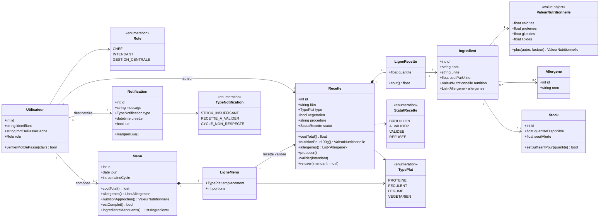

# Diagramme de classes (T-06)

Première version issue du cadrage. À faire évoluer à chaque sprint qui touche au modèle.

## Choix de modélisation à justifier dans le rapport

| Choix | Raison |
| --- | --- |
| `ValeurNutritionnelle` en *value object* | Les valeurs nutritionnelles n'ont pas d'identité propre ; on les additionne et on les divise, c'est un calcul, pas une entité |
| `LigneRecette` comme classe d'association | Elle porte la **quantité**, qui n'appartient ni à la recette ni à l'ingrédient seuls |
| `Stock` séparé de `Ingredient` | Le stock est **simulé** et évolue indépendamment de la fiche ingrédient ; on peut le remplacer plus tard par un vrai système |
| Allergènes **dérivés** et non saisis sur la recette | Les allergènes d'une recette sont l'union de ceux de ses ingrédients : les saisir deux fois créerait des incohérences |
| `statut` sur `Recette` | Le workflow de validation (E3) est un état de la recette, pas une entité distincte |
| `Menu` avec 5 `LigneMenu` | Contrainte métier S-09 : 2 protéines, 1 féculent, 1 légume, 1 végétarien — la cardinalité documente la règle, `estComplet()` la vérifie |
