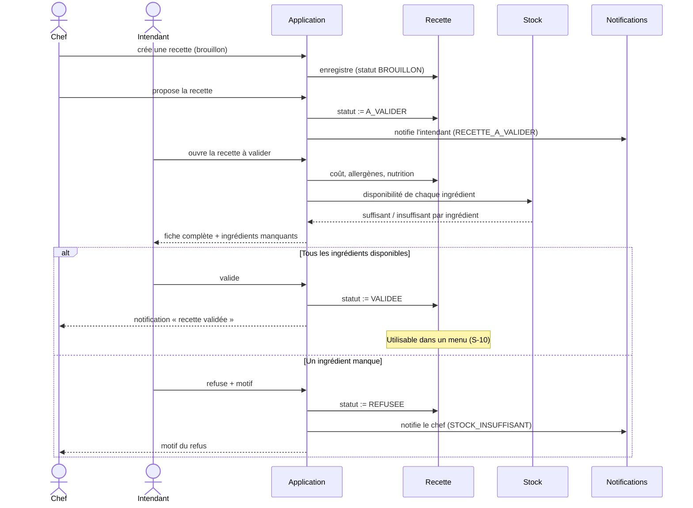

# Diagramme de séquence — Workflow de validation d'une recette

Couvre les stories **S-06** (le chef propose) et **S-08** (l'intendant valide ou refuse selon
le stock), avec la notification **S-14**.

